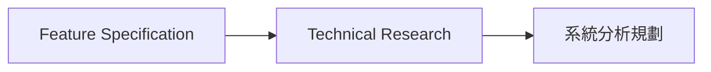
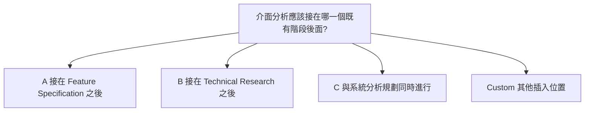

# Rule 1 - 澄清目標必須影響核心決策

- Clarification 必須用於會改變任務目標、Artifact 契約、功能範圍、資料歸屬、使用者旅程、驗收結果、安全隱私要求、技術決策邊界或後續工作邊界的缺口。
- 不影響核心決策且可以保守推導的缺口必須寫入回覆 Artifact 的未阻塞事項，不得寫入目標檔案。
- Clarification 不得詢問不影響後續執行的偏好細節、可逆的表面樣式、內部實作細節或可由後續階段自然決定的內容。
- 每次提問最多必須輸出五個 Clarification，且必須依影響排序。
- 輸出題數必須依核心缺口決定。
- 輸出題數不得依 Template 範例中的題數決定。

## Good Example

- 問題會改變 Artifact 契約與後續工程邊界，因此適合提出 Clarification。

```markdown
## Question 1: 目標 Artifact 的穩定輸出

**Context**: 使用者要求建立可重複產出報告的 Skill，但尚未指定報告是否必須包含互動圖表。

**What we need to know**: 目標報告是否必須包含互動圖表，還是只需要靜態 Markdown 結構?
```

## Bad Example

- 問題只涉及非阻塞偏好，沒有改變核心決策或後續執行。

```markdown
## Question 1: 標題符號

**Context**: 回覆 Artifact 尚未指定標題前要不要加裝飾符號。

**What we need to know**: 標題前要不要加星號?
```

# Rule 2 - 澄清問題必須具體且可回答

- 每個 Clarification 必須包含 Context、What we need to know、Suggested Answers、推薦與 Your choice。
- Context 必須引用或摘要使用者輸入、目標檔案或既有 Artifact 中造成不確定的內容。
- What we need to know 必須是一個具體問題。
- Suggested Answers 必須提供 A、B、C 與 Custom 四個選項，且必須包含推薦欄。
- 四個選項中必須恰好有一個選項的推薦欄標為「推薦」。
- 其餘選項的推薦欄必須留空。
- 推薦不得成為 A、B、C、Custom 以外的第五個選項。
- 每個選項必須說明對目標任務、Artifact、決策或後續工作的影響。
- 推薦必須寫出被標為「推薦」的選項與其理由，且必須放在 Your choice 之前。
- Your choice 必須讓使用者回覆 A、B、C 或 Custom。

## Good Example

- 同一題包含上下文、四個選項、恰好一個推薦與推薦理由，使用者仍可改選其他選項。

```markdown
## Question 1: 交付形式

**Context**: 使用者要求產出一份分析結果，但尚未指定結果應直接回覆、寫入文件或建立互動 Canvas。

**What we need to know**: 本次分析結果應該以哪種形式交付?

**Suggested Answers**:

| Option | Answer | Implications | 推薦 |
|--------|--------|--------------|------|
| A | 直接在回覆中提供摘要 | 不建立新檔案，適合一次性決策或簡短結果 | |
| B | 寫入指定 Markdown 文件 | 產生可追蹤 Artifact，後續可維護與審查 | 推薦 |
| C | 建立 Canvas | 適合資料量大、需要視覺布局或互動探索的結果 | |
| Custom | 使用者提供其他交付方式 | 依使用者答案調整輸出形式與後續步驟 | |

**推薦**: B — 產生可追蹤 Artifact，後續可維護與審查。

**Your choice**: _請回覆 Q1: A/B/C 或 Custom - 你的答案_
```

## Bad Example

- 同一題保留了四個選項，但沒有推薦欄與推薦理由。

````markdown
## Question 1: 交付形式

**Context**: 使用者要求產出一份分析結果，但尚未指定結果應直接回覆、寫入文件或建立互動 Canvas。

**What we need to know**: 本次分析結果應該以哪種形式交付?

**Suggested Answers**:

| Option | Answer | Implications |
|--------|--------|--------------|
| A | 直接在回覆中提供摘要 | 不建立新檔案，適合一次性決策或簡短結果 |
| B | 寫入指定 Markdown 文件 | 產生可追蹤 Artifact，後續可維護與審查 |
| C | 建立 Canvas | 適合資料量大、需要視覺布局或互動探索的結果 |
| Custom | 使用者提供其他交付方式 | 依使用者答案調整輸出形式與後續步驟 |

**Your choice**: _請回覆 Q1: A/B/C 或 Custom - 你的答案_
````

# Rule 3 - 提問排序必須依風險與影響

- Clarification 必須依 `task goal > artifact contract > scope > security/privacy > data ownership > user journey > acceptance result > implementation preference > style detail` 排序。
- 當可提出的問題超過五個時，必須只保留排序最高的五個。
- 被排除且不阻塞核心決策的缺口必須寫入回覆 Artifact 的未阻塞事項，不得寫入目標檔案。
- 被排除但仍阻塞核心決策的缺口必須在回覆中標明仍未解決，不得改寫目標檔案的狀態。

## Good Example

- 問題排序先處理任務目標與 Artifact 契約，再處理交付細節。

```markdown
1. 這個 Skill 要支援哪些使用情境? (task goal)
2. 最終 Artifact 是否需要固定模板? (artifact contract)
3. 回覆要寫入檔案還是只回覆摘要? (acceptance result)
```

## Bad Example

- 排序先問低風險風格細節，卻延後會影響任務目標的問題。

```markdown
1. Markdown 標題要不要加 emoji? (style detail)
2. 範例文字要不要使用第一人稱? (style detail)
3. 這個 Skill 要支援哪些使用情境? (task goal)
```

# Rule 4 - mermaid 只描述需要看圖的問題情境

- 當 Clarification 所問的情境包含流程、狀態、關係或結構，且缺少該情境的圖就無法判斷問題範圍時，該題必須在 Suggested Answers 之前加入 mermaid 圖。
- 該 mermaid 圖必須只描述被詢問的情境。
- mermaid 圖不得描繪 Suggested Answers 的選項、推薦或影響分支。
- 當 Context 與 What we need to know 已足以判斷問題範圍時，該題不得加入 mermaid 圖。

## Good Example

- 問題在問介面分析要插入既有流程的哪裡，圖只畫出被詢問的流程，選項留在表格。

````markdown
## Question 1: 介面分析插入點

**Context**: 規格完成後進入技術研究，研究完成後才做系統分析規劃。使用者要釐清介面分析插在這段流程的哪裡。

**What we need to know**: 介面分析應該接在哪一個既有階段後面?



**Suggested Answers**:

| Option | Answer | Implications | 推薦 |
|--------|--------|--------------|------|
| A | 接在 Feature Specification 之後 | 介面分析早於技術研究，研究無法約束介面範圍 | |
| B | 接在 Technical Research 之後 | 研究結果先約束介面範圍，再進入系統分析規劃 | 推薦 |
| C | 與系統分析規劃同時進行 | 介面與整體規劃一起變動，插入點不再單獨決定 | |
| Custom | 使用者提供其他插入位置 | 依使用者答案調整流程邊界 | |

**推薦**: B — 研究結果先約束介面範圍，再進入系統分析規劃。

**Your choice**: _請回覆 Q1: A/B/C 或 Custom - 你的答案_
````

## Bad Example

- 同一題改把 A、B、C 畫成流程圖，沒有畫出被詢問的規格、研究與規劃流程。

````markdown
## Question 1: 介面分析插入點

**Context**: 規格完成後進入技術研究，研究完成後才做系統分析規劃。使用者要釐清介面分析插在這段流程的哪裡。

**What we need to know**: 介面分析應該接在哪一個既有階段後面?



**Suggested Answers**:

| Option | Answer | Implications | 推薦 |
|--------|--------|--------------|------|
| A | 接在 Feature Specification 之後 | 介面分析早於技術研究，研究無法約束介面範圍 | |
| B | 接在 Technical Research 之後 | 研究結果先約束介面範圍，再進入系統分析規劃 | 推薦 |
| C | 與系統分析規劃同時進行 | 介面與整體規劃一起變動，插入點不再單獨決定 | |
| Custom | 使用者提供其他插入位置 | 依使用者答案調整流程邊界 | |

**推薦**: B — 研究結果先約束介面範圍，再進入系統分析規劃。

**Your choice**: _請回覆 Q1: A/B/C 或 Custom - 你的答案_
````

# Rule 5 - 鎖定題目必須照題輸出

- 呼叫者已提供鎖定題目時，必須依該順序輸出這些題目。
- 不得新增、刪除或改問另一個決策。
- 鎖定題目超過五題時，必須只保留呼叫者排序的前五題。
- 鎖定題目缺少問句格式所需欄位時，必須只補齊格式，不得改變原本要決定的事。

## Good Example

- 呼叫者鎖定原始照片的去向，輸出仍問這一件事。

```markdown
鎖定題目：原始照片加入相簿後，檔案應保留在原處嗎?
輸出問句：原始照片加入相簿後，檔案應保留在原處嗎?
```

## Bad Example

- 呼叫者鎖定的是原始照片去向，輸出卻改問資料庫選型。

```markdown
鎖定題目：原始照片加入相簿後，檔案應保留在原處嗎?
輸出問句：規格應該使用 PostgreSQL 還是 SQLite?
```

# Rule 6 - 回答不得寫入目標檔案

- 澄清結果必須只寫入回覆 Artifact。
- 不得把使用者回答、決策摘要、假設或狀態寫入目標檔案。
- 不阻塞的排除項必須寫入回覆的未阻塞事項。
- 因題數上限未問、但仍阻塞核心決策的缺口，必須在回覆中標明仍未解決。

## Good Example

- 問題與未阻塞事項都留在回覆，目標規格檔沒有被改寫。

```markdown
## Question 1: 原始照片的去向

**What we need to know**: 原始照片加入相簿後，檔案應保留在原處嗎?

未阻塞事項：日期分組預設使用拍攝日期。
```

## Bad Example

- 回答被直接寫進目標規格的假設與狀態。

```markdown
**狀態 ( Status )**：Ready for Planning

## 假設 ( Assumptions )

- 原始照片保留在原處。
```
