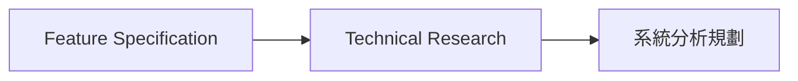

## Question 1: 交付形式

**Context**: 使用者要求產出一份分析結果，但尚未指定結果應直接回覆、寫入文件或建立互動 Canvas。

**What we need to know**: 本次分析結果應該以哪種形式交付?

**Suggested Answers**:

| Option | Answer | Implications | 推薦 |
|--------|--------|--------------|------|
| A | 直接在回覆中提供摘要 | 不建立新檔案，適合一次性決策或簡短結果 | |
| B | 寫入指定 Markdown 文件 | 產生可追蹤 Artifact，後續可維護與審查 | 推薦 |
| C | 建立 Canvas | 適合資料量大、需要視覺布局或互動探索的結果 | |
| Custom | 使用者提供其他交付方式 | 依使用者答案調整輸出形式與後續步驟 | |

**推薦**: B — 產生可追蹤 Artifact，後續可維護與審查。

**Your choice**: _請回覆 Q1: A/B/C 或 Custom - 你的答案_

## Question 2: 介面分析插入點

**Context**: 規格完成後進入技術研究，研究完成後才做系統分析規劃。使用者要釐清介面分析插在這段流程的哪裡。

**What we need to know**: 介面分析應該接在哪一個既有階段後面?

**Suggested Answers**:

| Option | Answer | Implications | 推薦 |
|--------|--------|--------------|------|
| A | 接在 Feature Specification 之後 | 介面分析早於技術研究，研究無法約束介面範圍 | |
| B | 接在 Technical Research 之後 | 研究結果先約束介面範圍，再進入系統分析規劃 | 推薦 |
| C | 與系統分析規劃同時進行 | 介面與整體規劃一起變動，插入點不再單獨決定 | |
| Custom | 使用者提供其他插入位置 | 依使用者答案調整流程邊界 | |

**推薦**: B — 研究結果先約束介面範圍，再進入系統分析規劃。

**Your choice**: _請回覆 Q2: A/B/C 或 Custom - 你的答案_
